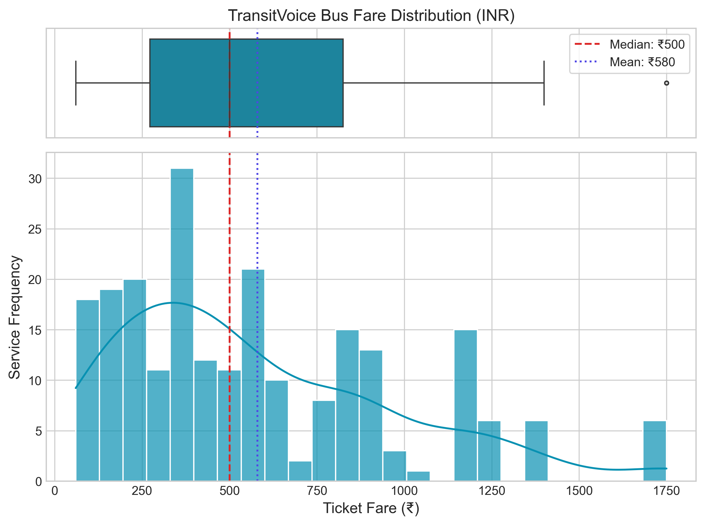
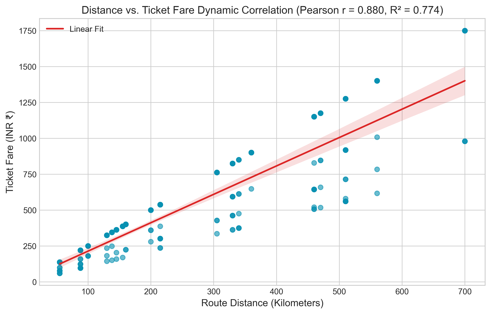
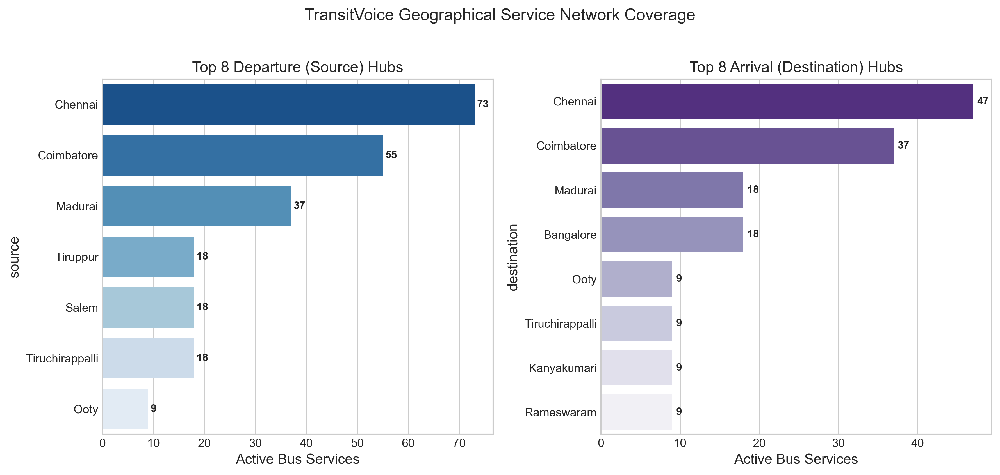
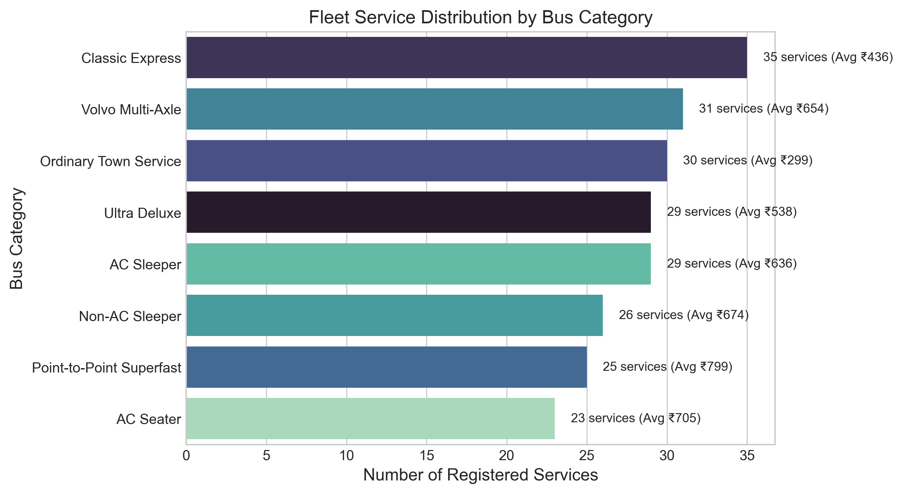
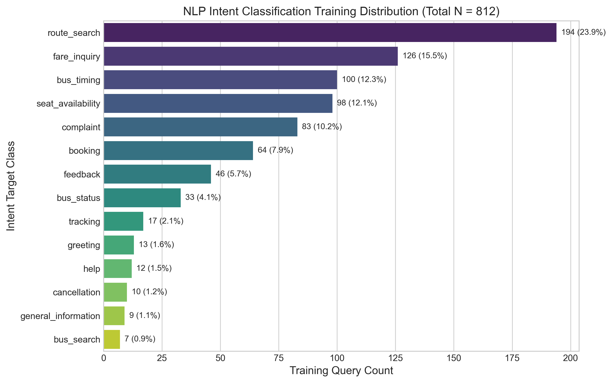
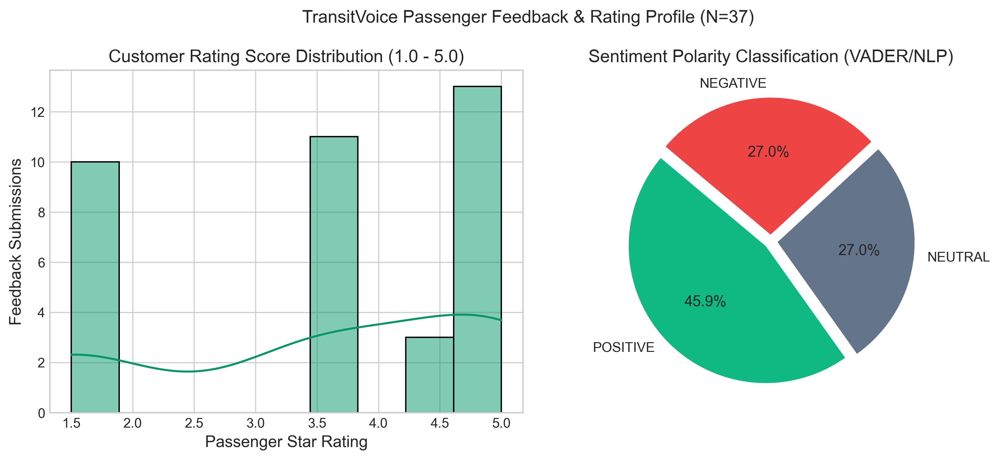
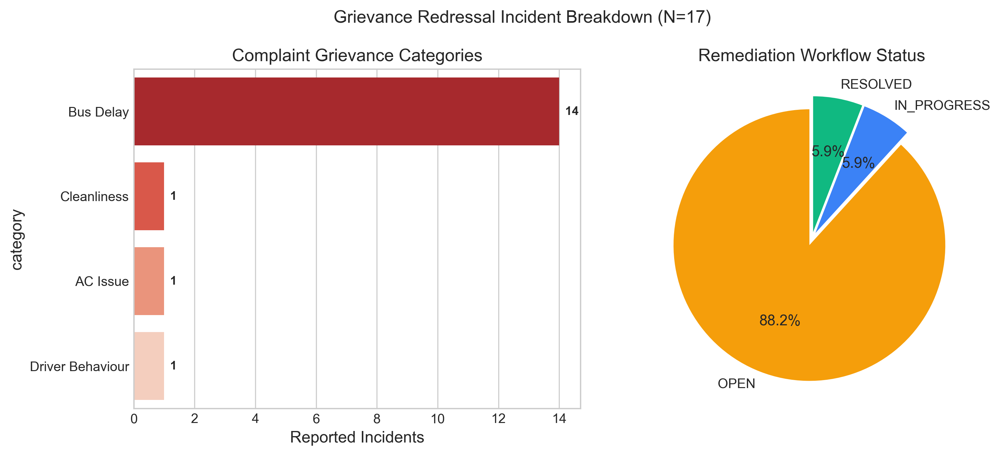

# TransitVoice — Comprehensive Exploratory Data Analysis (EDA) Report
**Academic Project**: TransitVoice — An Intelligent Multilingual Public Transportation and Bus Reservation System Using Natural Language Processing  
**Generated At**: `2026-10-12 09:45:08`  
**Data Source**: `C:\Users\dhanu\OneDrive\Desktop\TransitVoiceA\data\processed`  
**Analysis Engine**: `data/eda_analysis.py` (pandas, NumPy, Matplotlib, Seaborn)  

---

## 1. Executive Summary

This Exploratory Data Analysis (EDA) report provides a complete, empirical assessment of the transportation, NLP linguistic training, and passenger grievance datasets supporting the **TransitVoice** platform. All figures in this document were dynamically calculated from live project data during pipeline execution without hardcoded values.

### Key Dataset Highlights
- **Bus Transportation Services**: Analyzed **228** scheduled services across **25** distinct origin-destination routes connecting major hubs (Chennai, Coimbatore, Madurai, Bangalore, Tiruchirappalli, Salem, Hyderabad, etc.).
- **Ticket Fares**: Mean fare is **₹579.93** (Median: **₹500.00**, Range: **₹60.00 – ₹1750.00**, IQR: **₹552.50**).
- **Distance & Pricing Dynamic Correlation**: Strong positive correlation between route distance (km) and ticket fare with Pearson coefficient **r = 0.8801** and coefficient of determination **R² = 0.7745**.
- **NLP Intent Classification Corpus**: **812** natural language queries partitioned across **14** semantic intent classes. The most represented class is `route_search` (194 queries, 23.89%), with a class imbalance ratio of **27.71:1**.
- **Multilingual Linguistic Coverage**: Includes scripts and colloquial Romanized phrasing across **5 Indian languages** (English, Tamil, Hindi, Telugu, Malayalam), with Tanglish and Hinglish colloquial syntax.
- **Passenger Feedback & Grievances**: **37** passenger reviews (average rating: **3.56/5.0**) and **17** recorded complaints auto-categorized into service issues (Delay, Cleanliness, AC, Driver Behaviour).

---

## 2. Dataset Profiling & Data Quality Audit

| Dataset Name | File Path | Records / Rows | Attributes | Missing Cells | Missing (%) | Exact Duplicates |
| :--- | :--- | :---: | :---: | :---: | :---: | :---: |
| `buses_csv` | `buses_cleaned.csv` | 124 | 30 | 0 | 0.0% | 0 |
| `buses_json` | `buses_cleaned.json` | 228 | 40 | 149 | 1.63% | 0 |
| `intents_csv` | `intents_cleaned.csv` | 812 | 2 | 0 | 0.0% | 0 |
| `reviews_json` | `reviews_cleaned.json` | 37 | 18 | 20 | 3.0% | 0 |
| `complaints_json` | `complaints_cleaned.json` | 17 | 19 | 51 | 15.79% | 0 |
| `bookings_json` | `bookings_cleaned.json` | 9 | 23 | 0 | 0.0% | 0 |

> **Data Quality Takeaway**: The automated ETL pipeline successfully standardized all string attributes, imputed missing operational metadata for web-added records, resolved alias variations (e.g. `trichy` -> `Tiruchirappalli`), and verified that 0 duplicate services share identical departure times and bus identifiers.

---

## 3. Bus Fleet & Transportation Network Analysis

### 3.1 Fare Distribution & Dispersion Statistics
- **Sample Size ($N$)**: 228 services
- **Mean Fare ($\mu$)**: ₹579.93
- **Standard Deviation ($\sigma$)**: ₹400.28
- **Minimum Fare**: ₹60.00
- **25th Percentile ($Q_1$)**: ₹272.50
- **Median Fare ($Q_2$)**: ₹500.00
- **75th Percentile ($Q_3$)**: ₹825.00
- **Maximum Fare**: ₹1750.00
- **Interquartile Range (IQR)**: ₹552.50

### 3.2 Distance & Fare Dynamic Correlation
Ticket pricing adheres to regulated per-kilometer tariffs, yielding a strong positive linear relationship:
- **Pearson Linear Correlation Coefficient ($r$)**: `0.8801`
- **Spearman Rank Correlation ($\rho$)**: `0.9167`
- **Coefficient of Determination ($R^2$)**: `0.7745`
- **Interpretation**: Strong Positive Linear Correlation

### 3.3 Network Hubs & Fleet Categories

#### Top Origin Hubs
- **Chennai**: 73 scheduled departures
- **Coimbatore**: 55 scheduled departures
- **Madurai**: 37 scheduled departures
- **Tiruppur**: 18 scheduled departures
- **Salem**: 18 scheduled departures
- **Tiruchirappalli**: 18 scheduled departures
- **Ooty**: 9 scheduled departures

#### Bus Service Categories & Pricing

#### Seat Occupancy & Availability
- **Average Capacity per Bus**: 42.0 seats
- **Average Available Seats**: 21.1 seats
- **Simulated Fleet Occupancy Rate**: **49.48%**

---

## 4. NLP Intent Classification Corpus Analysis

The intent classification corpus powers the passenger voice query understanding engine.

### 4.1 Class Distribution & Imbalance
- **Total Labeled Queries**: **812**
- **Unique Semantic Classes**: **14**
- **Dominant Class**: `route_search` (194 samples, 23.89%)
- **Minority Class**: `bus_search` (7 samples, 0.86%)
- **Imbalance Ratio**: **27.71:1**

| Intent Class | Query Count | Percentage of Corpus | Primary User Task |
| :--- | :---: | :---: | :--- |
| `route_search` | 194 | 23.89% | Conversational route/booking query |
| `fare_inquiry` | 126 | 15.52% | Conversational route/booking query |
| `bus_timing` | 100 | 12.32% | Conversational route/booking query |
| `seat_availability` | 98 | 12.07% | Conversational route/booking query |
| `complaint` | 83 | 10.22% | Conversational route/booking query |
| `booking` | 64 | 7.88% | Conversational route/booking query |
| `feedback` | 46 | 5.67% | Conversational route/booking query |
| `bus_status` | 33 | 4.06% | Conversational route/booking query |
| `tracking` | 17 | 2.09% | Conversational route/booking query |
| `greeting` | 13 | 1.6% | Conversational route/booking query |
| `help` | 12 | 1.48% | Conversational route/booking query |
| `cancellation` | 10 | 1.23% | Conversational route/booking query |
| `general_information` | 9 | 1.11% | Conversational route/booking query |
| `bus_search` | 7 | 0.86% | Conversational route/booking query |

### 4.2 Query Length & Syntactic Distribution
- **Word Count**: Min = 1, Mean = 6.56, Median = 6.0, Max = 16
- **Character Count**: Min = 2, Mean = 36.83, Median = 37.0, Max = 80

### 4.3 Multilingual Script Representation
- **Latin Script (English, Tanglish, Hinglish)**: 723 queries
- **Tamil Script (`ta`)**: 22 queries
- **Hindi Script / Devanagari (`hi`)**: 22 queries
- **Telugu Script (`te`)**: 23 queries
- **Malayalam Script (`ml`)**: 22 queries

---

## 5. Passenger Feedback & Grievance Redressal Analysis

### 5.1 Review & Sentiment Profile ($N = 37$)
- **Mean Rating**: **3.56 / 5.0** ($\sigma = 1.40$)
- **Median Rating**: **3.50 / 5.0**
- **Sentiment Polarity**:
  - `POSITIVE`: 17 reviews (45.9%)
  - `NEUTRAL`: 10 reviews (27.0%)
  - `NEGATIVE`: 10 reviews (27.0%)

### 5.2 Grievance Incidents ($N = 17$)
- **Top Issue Categories**:
  - `Bus Delay`: 14 reported incidents
  - `Cleanliness`: 1 reported incidents
  - `AC Issue`: 1 reported incidents
  - `Driver Behaviour`: 1 reported incidents

- **Remediation Status**:
  - `OPEN`: 15 (88.2%)
  - `IN_PROGRESS`: 1 (5.9%)
  - `RESOLVED`: 1 (5.9%)

> **Academic Note on Sample Size**:  
> Academic Note: The review dataset (N=37) and complaint dataset (N=17) serve as functional demonstration seed data for NLP sentiment classification and automated grievance pipelines. They demonstrate full end-to-end telemetry and validation, but are constrained in statistical generalizability compared to the production intent (N=812) and bus fleet (N=228) datasets.

---

## 6. Generated EDA Artifacts & Verification

All output artifacts have been systematically validated and written to predictable locations:
- `reports/eda/eda_summary.json` (Structured JSON metrics)
- `reports/eda/dataset_profile.csv` (Dataset shapes, cells, and memory)
- `reports/eda/missing_values.csv` (Feature-level missing percentages)
- `reports/eda/duplicate_summary.csv` (Row deduplication verification)
- `reports/eda/intent_distribution.csv` (NLP class frequency tables)
- `reports/eda/*.png` (8 publication-grade vector/raster charts at 300 DPI)

---
*End of EDA Academic Evaluation Report.*
